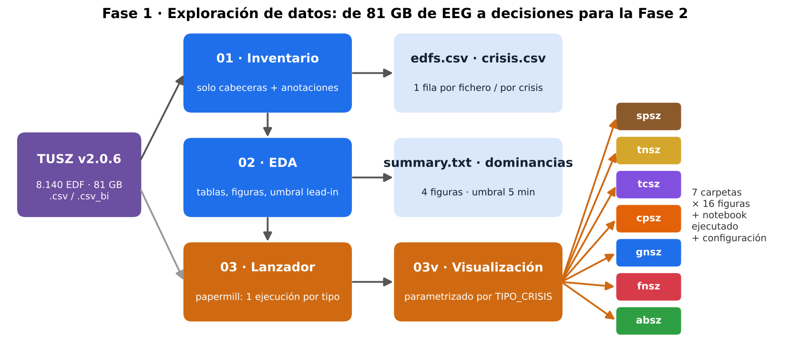
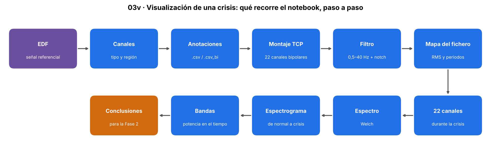
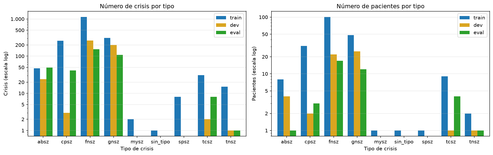
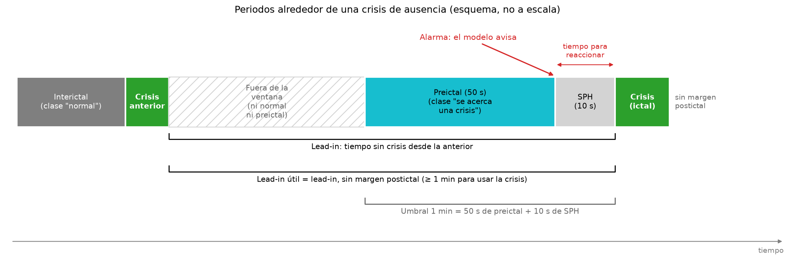
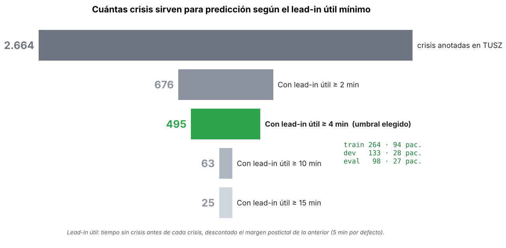
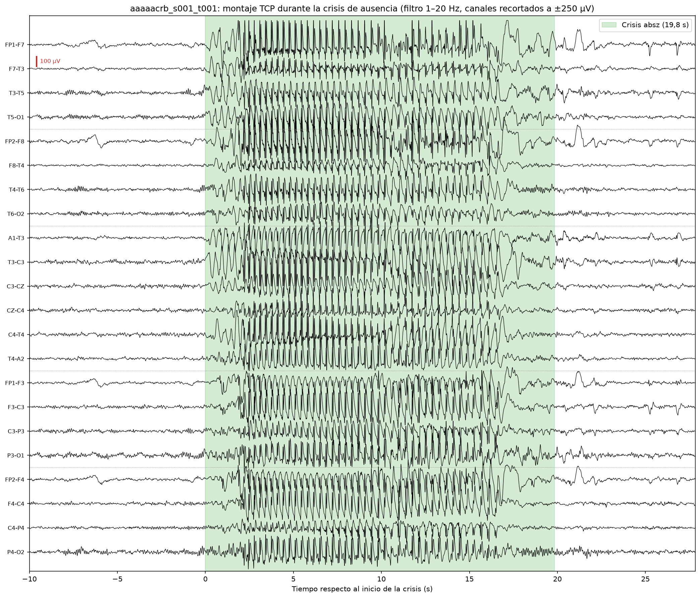
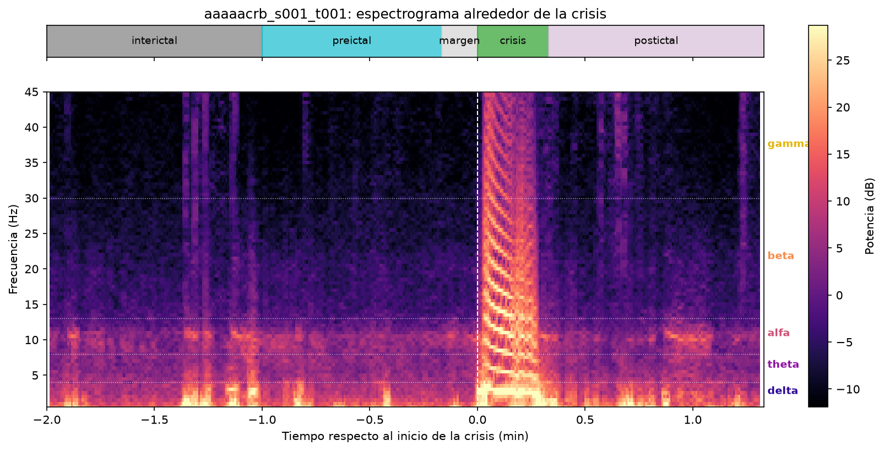
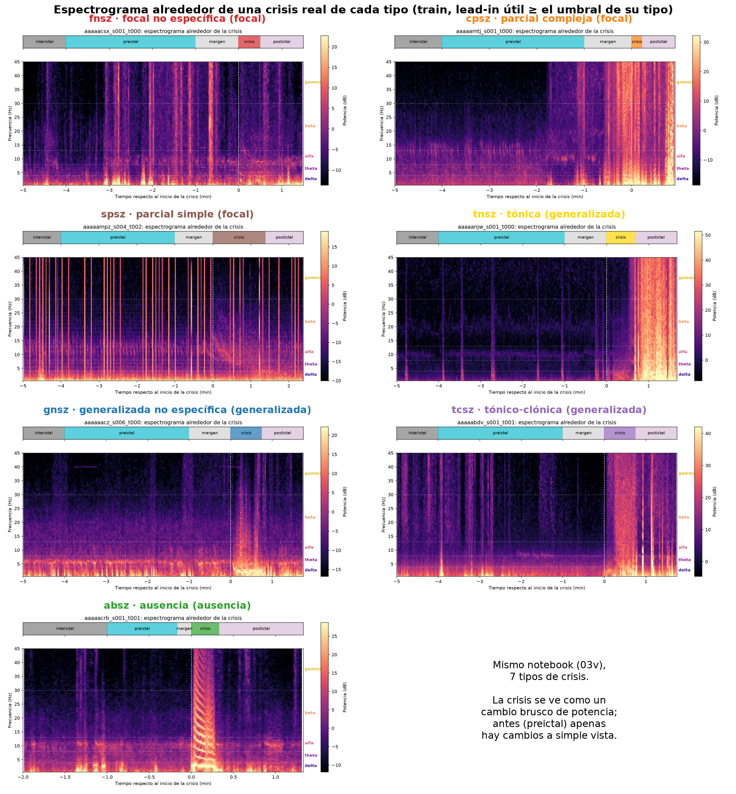
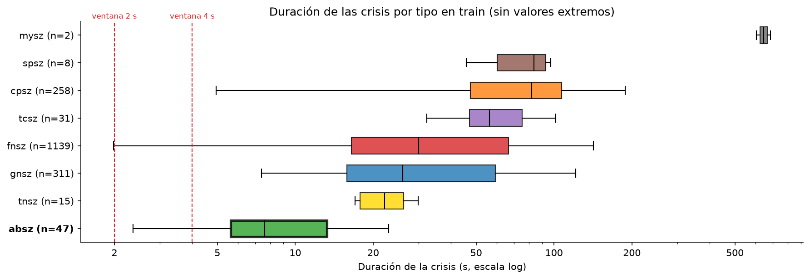
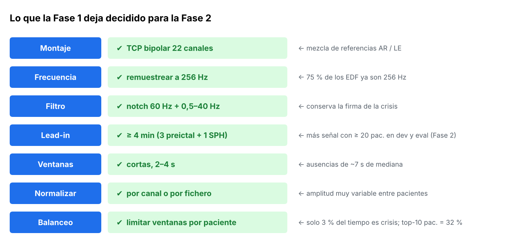

<div align="center">

# 🔍 Fase 1 · Exploración de datos

### Entender TUSZ antes de entrenar nada

*De 81 GB de EEG a un puñado de decisiones claras para la Fase 2.*


</div>

---

## 📋 Índice

- [🎯 Qué se hace en esta fase](#-qué-se-hace-en-esta-fase)
- [🧭 Flujo de trabajo](#-flujo-de-trabajo)
- [📓 Los notebooks](#-los-notebooks)
- [📊 Resultados que se obtienen](#-resultados-que-se-obtienen)
- [✅ Lo que queda decidido para la Fase 2](#-lo-que-queda-decidido-para-la-fase-2)
- [▶️ Cómo ejecutarla](#️-cómo-ejecutarla)
- [📁 Archivos generados](#-archivos-generados)

---

## 🎯 Qué se hace en esta fase

| | Pregunta | Dónde se responde |
|---|---|---|
| 📦 | ¿Qué hay en el corpus? Ficheros, pacientes, montajes, frecuencias, crisis | `01` inventario |
| 📈 | ¿Cómo se reparten las crisis por tipo y partición? ¿Cuántas sirven para **predecir**? | `02` EDA |
| ⚡ | ¿Cómo es **de verdad** una crisis en la señal? ¿Se ve algo **antes**? | `03` + `03v` visualización |

> 💬 Esta fase **no entrena ningún modelo**. Su resultado son datos ordenados, figuras y **decisiones justificadas** (montaje, frecuencia, filtro, umbral de lead-in…).

---

## 🧭 Flujo de trabajo

<div align="center">

</div>

- **01 → 02**: el inventario se ejecuta **una vez** (lee solo cabeceras, tarda minutos). El EDA se puede repetir sin volver a recorrer los 81 GB.
- **03 → 03v**: un único notebook de visualización (`03v`) parametrizado con `TIPO_CRISIS`. El lanzador `03` lo ejecuta con **papermill** para cada tipo. Un solo notebook que mantener.

---

## 📓 Los notebooks

| | Notebook | Qué hace | Lee | Genera |
|---|---|---|---|---|
| 1️⃣ | `01_inventario_tusz.ipynb` | Recorre los 8.140 EDF: cabeceras, montaje, frecuencia, duración y crisis (`.csv` + `.csv_bi`). Calcula el **lead-in** de cada crisis | `00.TUSZ/` | `outputs/fase_01/01_inventario/` |
| 2️⃣ | `02_eda_tusz.ipynb` | Tablas resumen, dominancias, recuento por **umbral de lead-in**, figuras y conclusiones | `01_inventario/` | `outputs/fase_01/02_eda/` |
| 3️⃣ | `03_ejecutar_visualizaciones.ipynb` | **Lanzador**: ejecuta el `03v` para 🟩 `absz` (🔹) 🟥 `fnsz` (♦️) 🟦 `gnsz` (🔷) 🟧 `cpsz` (♦️) 🟪 `tcsz` (🔷) 🟨 `tnsz` (🔷) 🟫 `spsz` (♦️) | `03v` | una carpeta por tipo |
| 🔬 | `03v_visualizacion_crisis.ipynb` | Abre la **señal EEG** de una crisis real (🔵 train, lead-in útil ≥ el umbral de su tipo): montaje TCP, filtrado, espectro, espectrograma, bandas y conclusiones | EDF + inventario | `03_visualizacion/<tipo>/` |

> 🔳 `mysz` (🔷) queda fuera de la visualización: solo 2 crisis, del mismo paciente y sin lead-in suficiente.

### Qué recorre el `03v`, paso a paso

<div align="center">

</div>

---

## 📊 Resultados que se obtienen

### 1. El corpus en cifras

| Partición | 👥 Pacientes | 📄 Ficheros | ⏱️ Horas | ⚡ Crisis |
|---|---:|---:|---:|---:|
| 🔵 `train` | 579 | 5.057 | 910,7 | 1.812 |
| 🟡 `dev` | 53 | 2.203 | 435,5 | 492 |
| 🟢 `eval` | 43 | 880 | 128,6 | 360 |

✅ **0 pacientes compartidos** entre particiones (sin *data leakage*).

<div align="center">

</div>

- 🟥 `fnsz` (♦️) + 🟦 `gnsz` (🔷) + 🟧 `cpsz` (♦️) = **93 %** de las crisis.
- 🟩 `absz` (🔹): muy cortas (mediana **7 s**) y las 49 de 🟢 eval son de **un solo paciente**.

### 2. Cuántas crisis sirven para predecir: el lead-in

El **lead-in** es el tiempo **sin crisis** antes de cada crisis, dentro de su fichero. La ventana preictal tiene que caber dentro.

<div align="center">

</div>

<div align="center">

</div>

⭐ El umbral de lead-in del TFM es **4 min** (3 min de preictal + 1 min de SPH): es el que más señal preictal da en train dejando al menos 20 pacientes en dev y en eval.

**Lead-in útil.** Al lead-in se le descuenta el **margen postictal** de la crisis anterior (*lead-in útil*), y el margen, el umbral de lead-in y el SPH dependen del **tipo de crisis**. Se definen en `tfm_comun/umbrales.py`, en segundos: por defecto, 5 min de margen, **4 min de umbral** y 1 min de SPH; en las 🟩 ausencias, 0 s, 60 s y 10 s, porque son cortas, muy seguidas y casi sin postictal. El recuento con estos valores, y el análisis que llevó a elegir 4 min, están en `fase_02/01_seleccion_crisis.ipynb`.

### 3. Una crisis real, vista por dentro

Ejemplo principal: 🟩 **crisis de ausencia** (`aaaaacrb_s001_t001`, 19,8 s). Se ve la clásica punta-onda generalizada en los 22 canales a la vez.

<div align="center">

</div>

<div align="center">

</div>

### 4. Los 7 tipos con el mismo notebook

<div align="center">

</div>

Cada tipo genera **16 figuras** en `outputs/fase_01/03_visualizacion/<tipo>/figuras/`.

### 5. Conclusiones clave

- 🧠 **Detectar será más fácil que predecir**: la crisis destaca claramente; preictal e interictal se parecen mucho a simple vista.
- ⚠️ **Artefactos**: movimiento o electrodos sueltos disparan la amplitud más que la propia crisis. Un modelo podría aprender esos "atajos".
- ⏱️ **Duración muy distinta por tipo** → ventanas cortas.

<div align="center">

</div>

---

## ✅ Lo que queda decidido para la Fase 2

<div align="center">

</div>

---

## ▶️ Cómo ejecutarla

```text
1️⃣  01_inventario_tusz.ipynb          (una vez, unos minutos)
2️⃣  02_eda_tusz.ipynb
3️⃣  03_ejecutar_visualizaciones.ipynb  (≈ 20 s por tipo, 7 tipos)
```

> 💡 Para ver un solo tipo, abre `03v_visualizacion_crisis.ipynb` y cambia `TIPO_CRISIS` en la primera celda.

---

## 📁 Archivos generados

```
📂 outputs/fase_01/
├── 📂 01_inventario/
│   ├── edfs.csv              → 1 fila por EDF (split, paciente, montaje, fs, duración…)
│   ├── crisis.csv            → 1 fila por crisis (inicio, fin, tipo, lead-in…)
│   └── configuracion.json
├── 📂 02_eda/
│   ├── summary.txt           → resumen en texto de todo el EDA
│   ├── crisis_por_umbral_leadin.csv
│   ├── dominancia_{tipos, tipos_por_split, montajes, frecuencias}.csv
│   └── 📂 figuras/           → 4 figuras
└── 📂 03_visualizacion/
    ├── resumen_ejecuciones.csv   → tipo, ejemplo, estado, segundos, nº figuras
    └── 📂 <tipo>/                → absz · fnsz · gnsz · cpsz · tcsz · tnsz · spsz
        ├── 03v_visualizacion_<tipo>_<nombre>.ipynb   (notebook ejecutado)
        ├── configuracion.json · crisis_ejemplo.csv
        └── 📂 figuras/       → 16 figuras
```

> 💡 Los CSV se guardan **sin iconos**; los iconos solo se añaden al mostrar tablas.

---

<div align="center">

⬅️ [README del TFM](../../../README.md) · ➡️ Fase 2 · Preprocesado y ventanas *(próximamente)*

</div>
