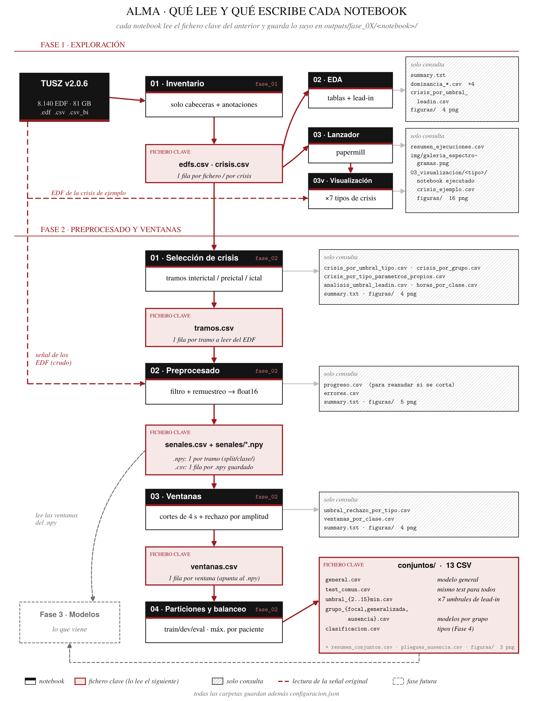
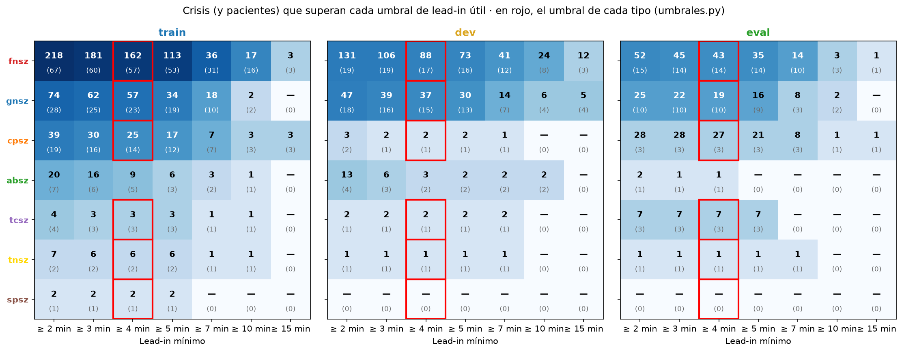
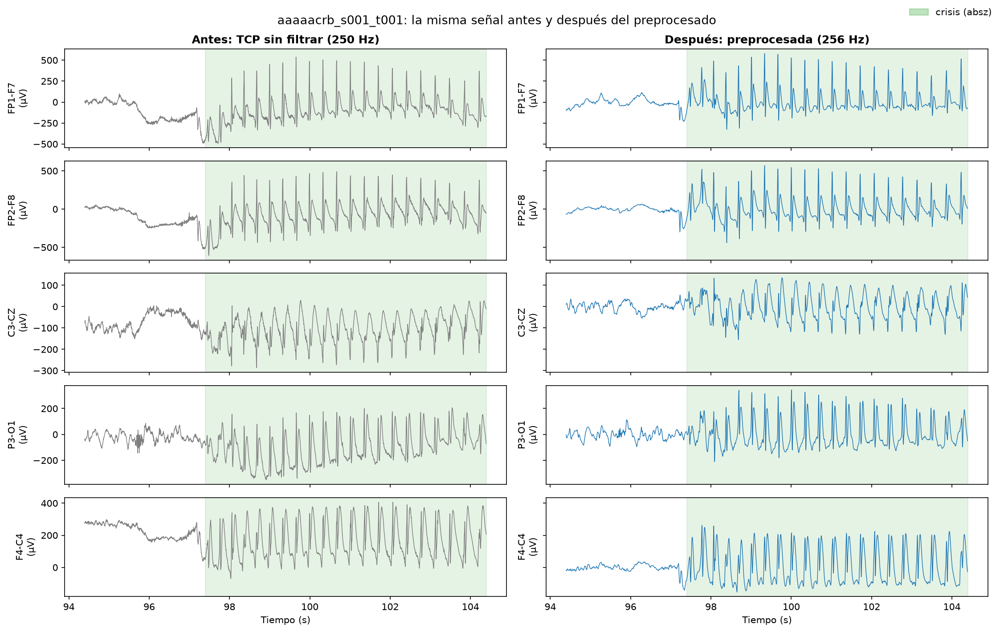
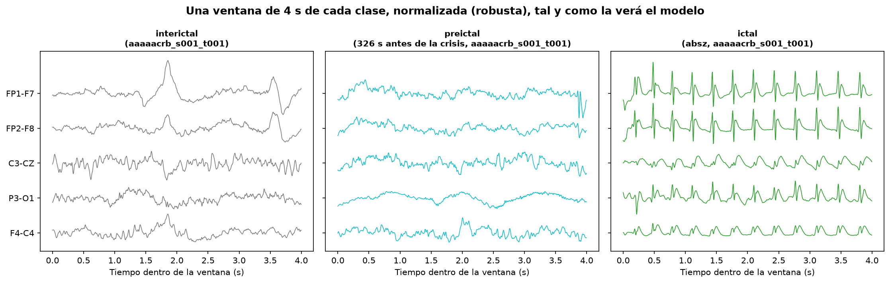
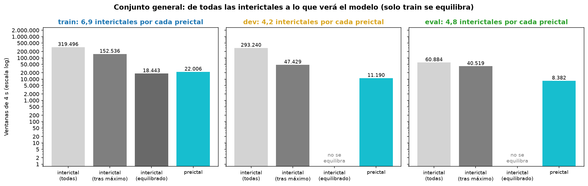

<div align="center">

# ⚙️ Fase 2 · Preprocesado y ventanas

### De los EDF en bruto a los conjuntos que verá cada modelo

*Qué trozos se usan, en qué formato, cortados en ventanas y repartidos por paciente.*


</div>

> ✏️ **Boceto.** Las cifras marcadas con ✏️ se actualizarán cuando se apliquen todas las correcciones y se ejecute la fase completa (no en modo prueba).

---

## 📋 Índice

- [🎯 Qué se hace en esta fase](#-qué-se-hace-en-esta-fase)
- [🧭 Flujo de trabajo](#-flujo-de-trabajo)
- [📓 Los notebooks](#-los-notebooks)
- [📊 Resultados que se obtienen](#-resultados-que-se-obtienen)
- [✅ Lo que queda listo para la Fase 3](#-lo-que-queda-listo-para-la-fase-3)
- [▶️ Cómo ejecutarla](#️-cómo-ejecutarla)
- [📁 Archivos generados](#-archivos-generados)

---

## 🎯 Qué se hace en esta fase

| | Pregunta | Dónde se responde |
|---|---|---|
| ✂️ | ¿**Qué trozos** de qué EDF se usan? ⏳ preictal, 💤 interictal y ⚡ ictal | `01` selección |
| 🎛️ | ¿Cómo se deja la señal **igual para todos los equipos**? | `02` preprocesado |
| 🪟 | ¿Cómo se corta en **ventanas** y cuáles se descartan? | `03` ventanas |
| ⚖️ | ¿Qué ventanas ve **cada modelo** para entrenar, validar y evaluar? | `04` particiones y balanceo |
| 🕵️ | ¿Hay **atajos** (pistas que no son EEG preictal) con los que un modelo podría acertar? | `05` auditoría de atajos |

> 💬 Esta fase **tampoco entrena ningún modelo**. Su resultado son señales en formato común y **tablas índice** listas para que la Fase 3 solo tenga que filtrar y cargar.

---

## 🧭 Flujo de trabajo

<div align="center">

</div>

- **01 → 02**: `01` solo apunta **tiempos** (no toca la señal). `02` lee únicamente los EDF de `tramos.csv`.
- **02 → 03 → 04**: la señal se guarda **una sola vez** (`.npy`). `ventanas.csv` y los conjuntos son **índices**: no se duplica la señal.
- La cadena de preprocesado (`tfm_comun/senal/`) es la **misma que usará la demo** en directo: filtro causal y funciones sin MNE.

---

## 📓 Los notebooks

| | Notebook | Qué hace | Lee | Genera |
|---|---|---|---|---|
| 1️⃣ | `01_seleccion_crisis.ipynb` | Limpia crisis, cuenta crisis y pacientes por **umbral de lead-in**, tipo y partición, y apunta los tramos ⏳ preictales, 💤 interictales y ⚡ ictales | `fase_01/01_inventario/` | `tramos.csv` |
| 2️⃣ | `02_preprocesado.ipynb` | Montaje **TCP de 22 canales**, remuestreo a **256 Hz**, filtrado causal, µV y **float16**. Mide la calidad de cada tramo | `tramos.csv` + EDF | `senales/*.npy` + `senales.csv` |
| 3️⃣ | `03_ventanas.ipynb` | Corta en ventanas de **4 s** (50 % de solape en ⏳ y ⚡), marca a qué modelo va cada una (`en_...`) y las de mala calidad o del **inicio del fichero** | `senales.csv` | `ventanas.csv` |
| 4️⃣ | `04_particiones_y_balanceo.ipynb` | Comprueba particiones por paciente, limita 💤 interictal por paciente, arma un conjunto por modelo y **equilibra solo train**, exactamente mitad y mitad en cada paciente | `ventanas.csv` | `conjuntos/<modelo>.csv` |
| 5️⃣ | `05_auditoria_atajos.ipynb` | Busca **atajos** (canales a 0, equipo, minuto del fichero, tipo de fichero): comprueba las correcciones de 03 y 04, semáforo por variable, **techo del atajo** (modelo que solo ve metadatos) y **dos conjuntos de control**: emparejado por posición y 💤 de la misma sesión. Todo se decide con los datos | `conjuntos/` + `senales.csv` + `edfs.csv` | `medidas_fase_03.csv` + `conjuntos_control/` |

---

## 📊 Resultados que se obtienen

### 1. Crisis que sirven para predecir

⭐ Umbral principal de lead-in: **4 min** (3 min de preictal + 1 min de SPH). Con el margen postictal descontado quedan:

| Partición | ⚡ Crisis | 👥 Pacientes |
|---|---:|---:|
| 🔵 `train` | 264 | 94 |
| 🟡 `dev` | 133 | 28 |
| 🟢 `eval` | 98 | 27 |

- Los umbrales de 2, 10 y 15 min se comparan de forma **orientativa** sobre un **test común** (115 crisis, 28 pacientes de 🟢 eval).
- **Por tipo no da** (solo 🟥 `fnsz` (♦️) y 🟦 `gnsz` (🔷) tienen pacientes suficientes) → modelo **general** y, como experimento, uno por **grupo de inicio** (♦️ focal · 🔷 generalizada · 🔹 ausencia).
- 🟩 `absz` (🔹): en 🟢 eval no se puede evaluar → **validación cruzada por paciente** en train + dev.

<div align="center">

</div>

### 2. La señal en formato común

- **7.665 tramos** (896 h) de 5.115 EDF, en 21 min y sin errores.
- **36,4 GB** en float16 (error de centésimas a décimas de µV).
- Ficheros sin A1/A2: sus 2 canales a 0, marcados en `mascara_canales`.

<div align="center">

</div>

### 3. Ventanas y calidad

- Ventanas de **4 s** (22 × 1.024 muestras).
- Rechazo por amplitud **fijo de 1.000 µV**, común a 💤 interictal y ⏳ preictal (sin atajos de amplitud). Las crisis no se pierden por amplitud.
- Se descartan las ventanas de los **primeros 10 s de cada fichero** (arranque del filtro), en todas las clases: solo las tenía 💤 interictal y la red las podía usar como pista (lo detectó `05`).
- ✏️ Ventanas por clase y descartadas: pendiente de la ejecución completa.

<div align="center">

</div>

### 4. Conjuntos por modelo

- Máximo de **2 h** de 💤 interictal por paciente.
- Train equilibrado **paciente a paciente** y **exacto** (mitad y mitad en cada paciente, `EQUILIBRADO_EXACTO`); 🟡 dev y 🟢 eval con su desbalance real (métricas honestas).
- Conjuntos: `general`, `umbral_<U>min`, `grupo_<grupo>`, `test_comun`, `clasificacion`.
- ✏️ Tamaños y desbalance de cada conjunto: pendiente de la ejecución completa.

<div align="center">

</div>

### 5. Conclusiones clave

- 🧹 El **margen postictal** cuesta crisis, pero evita que el modelo aprenda "acaba de haber una crisis".
- ⚠️ Hay **muchos artefactos**, también dentro de las crisis 🟥 `fnsz` (♦️), 🟦 `gnsz` (🔷) y 🟧 `cpsz` (♦️). 🟪 `tcsz` (🔷) se trata aparte.
- 🟩 `absz` (🔹) son las más limpias, pero muy cortas: algunas se quedan sin ventanas de 4 s.

---

## ✅ Lo que queda listo para la Fase 3

- 📦 Un conjunto por modelo en `conjuntos/`, listo para filtrar.
- 🔁 Pliegues por paciente para 🟩 `absz` (🔹).
- 🕵️ Medidas contra atajos en `05_auditoria_atajos/medidas_fase_03.csv` y **dos conjuntos de control** en `conjuntos_control/`: la red se evalúa en el conjunto normal **y en los controles**; el **techo del atajo** dice cuánto podría inflar la nota la posición.
- 📝 Pendiente en la Fase 3: **cargador** (lee cada ventana con `ruta` + `muestra_inicio` y normaliza al vuelo, z-score robusto) y **línea base** con `conjuntos/general.csv`.
- 📝 Pendiente en la Fase 4: probar también ventanas de **2 s**, sobre todo para 🟩 `absz` (🔹).

---

## ▶️ Cómo ejecutarla

```text
1️⃣  01_seleccion_crisis.ipynb
2️⃣  02_preprocesado.ipynb             (≈ 21 min, reanudable con progreso.csv)
3️⃣  03_ventanas.ipynb
4️⃣  04_particiones_y_balanceo.ipynb
5️⃣  05_auditoria_atajos.ipynb         (unos minutos: bootstrap por paciente)
```

> 💡 Requiere haber ejecutado antes `fase_01/01_inventario_tusz.ipynb`.

---

## 📁 Archivos generados

```
📂 outputs/fase_02/
├── 📂 01_seleccion/
│   ├── tramos.csv                → 1 fila por tramo (clase, tipo, grupo, EDF, inicio, fin)
│   ├── crisis_por_umbral_tipo.csv · analisis_umbral_leadin.csv
│   ├── crisis_por_grupo.csv · crisis_por_tipo_parametros_propios.csv
│   ├── horas_por_clase.csv · summary.txt · configuracion.json
│   └── 📂 figuras/               → 3 figuras
├── 📂 02_preprocesado/
│   ├── 📂 senales/<split>/<clase>/<id_tramo>.npy   → 22 × muestras, float16, µV
│   ├── senales.csv               → dónde está cada tramo y su calidad
│   ├── progreso.csv · errores.csv · summary.txt · configuracion.json
│   └── 📂 figuras/               → 4 figuras
├── 📂 03_ventanas/
│   ├── ventanas.csv              → 1 fila por ventana (origen, modelos en_..., calidad)
│   ├── umbral_rechazo_por_tipo.csv · ventanas_por_clase.csv
│   ├── summary.txt · configuracion.json
│   └── 📂 figuras/               → 4 figuras
└── 📂 04_particiones_y_balanceo/
    ├── 📂 conjuntos/<modelo>.csv → entrada de la Fase 3
    ├── resumen_conjuntos.csv · pliegues_ausencia.csv
    ├── summary.txt · configuracion.json
    └── 📂 figuras/               → 3 figuras
└── 📂 05_auditoria_atajos/
    ├── auditoria_variables.csv   → semáforo de cada posible atajo
    ├── modelo_metadatos.csv      → techo del atajo (AUROC con IC por paciente)
    ├── medidas_fase_03.csv       → qué aplicar en la Fase 3 (decidido por los datos)
    ├── 📂 conjuntos_control/<modelo>_emparejado_posicion.csv · <modelo>_misma_sesion.csv → controles para la Fase 3
    ├── summary.txt · configuracion.json
    └── 📂 figuras/               → 9 figuras
```

> ⚠️ `senales/` ocupa decenas de GB: **no subir a GitHub** (`outputs/**/senales/` en el `.gitignore`).
> 💡 Los CSV se guardan **sin iconos**; los iconos solo se añaden al mostrar tablas.

---

<div align="center">

⬅️ [Fase 1 · Exploración de datos](../fase_01/README.md) · ➡️ Fase 3 · Modelo de predicción *(próximamente)*

</div>
