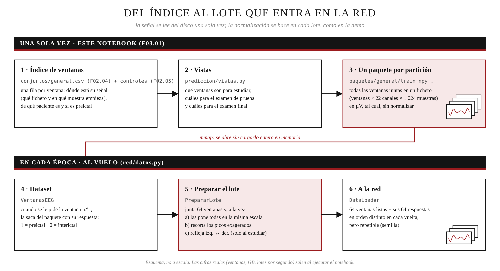

<div align="center">

# 🧠 Fase 3 · Modelo de predicción

### ⏳ preictal frente a 💤 interictal, con una red neuronal

*De los conjuntos de la Fase 2 a una red entrenada, evaluada por paciente y contrastada con los controles de atajos.*


</div>

> ✏️ **En curso.** Se completa a medida que se añadan notebooks.

## 🗺️ La historia de la fase

<div align="center">

</div>

La fase no fue en línea recta: la línea base (F03.02) salió casi el azar, la comprobación con la detección demostró que los datos estaban bien, y eso llevó a estudiar el **contexto** y la **normalización por paciente** (F03.03) antes de la red, que pasó a ser **F03.04**.

> 📘 **Guías para leer primero** (en `02.Notas/`): `Guia_F03_01_datos_red.pdf`, `Guia_F03_02_linea_base.pdf` y `Guia_F03_03_contexto_y_paciente.pdf`. Explican cada notebook con las cifras y figuras de la ejecución de noviembre de 2026.

---

## 📓 Los notebooks

| | Notebook | Qué hace | Lee | Genera |
|---|---|---|---|---|
| 1️⃣ | `01_datos_red.ipynb` | Arma las **vistas** (entrenamiento, validación, evaluación y controles de F02.05), mide el **peso de cada paciente**, lee cada ventana **una vez** a un **paquete por partición**, comprueba que es idéntico a la señal, elige la **normalización al vuelo** y monta el **Dataset y DataLoader** de PyTorch | `conjuntos/` (F02.04) + `conjuntos_control/` (F02.05) + `senales/` (F02.02) | `paquetes/<conjunto>/` + `vistas.csv` |
| 2️⃣ | `02_linea_base.ipynb` | **Línea base sin red**: resume cada ventana en 110 números (potencia relativa por banda y canal), entrena **regresión logística** y **XGBoost** (con y sin el mismo peso por paciente) y los mide en 🟡 dev: AUC con intervalo, **por paciente**, **por grupo de inicio** y qué bandas y canales usan. Es el **suelo** que tiene que superar la red. Incluye una **comprobación de la cadena**: con los mismos números, ¿se detecta la crisis (⚡ frente a 💤)? | paquetes 🔵 train y 🟡 dev de `01_datos_red/` | `caracteristicas/`, `modelos/`, `resultados_dev.csv`, `puntuaciones_validacion.csv`… |
| 3️⃣ | `03_contexto_y_paciente.ipynb` | **Estudio de contexto**: la ventana sigue siendo de 4 s, pero el modelo mira también los segundos de antes (4, 8, 16, 32 y 60 s en el modelo general; 4, 8 y 16 s en ausencias) y, por otro lado, compara a cada paciente consigo mismo. Mide cada combinación en 🟡 dev (global, por paciente y por grupo) y **decide qué recibe la red** | paquetes de `01_datos_red/` + señal de F02.02 + `02_linea_base/configuracion.json` | `resultados_contexto.csv`, `decision.csv`, `configuracion.json` (decisión para la red)… |
| 3️⃣b | `03b_atajo_grabacion.ipynb` | **El atajo de la grabación**: mide si un modelo puede reconocer, solo con 💤, si una sesión tiene crisis (la pista de la grabación), separa las 💤 de la misma sesión en **antes** y **después** de una crisis (postictal) y comprueba si el **montaje** original deja una firma (canales vacíos) y prueba con XGBoost tres arreglos al entrenar: solo 💤 de la **misma sesión**, solo las de **antes** de la crisis y solo el montaje **`01_tcp_ar`**. Mide todo con las ventanas de F03.03. Decide con el **control estricto** (⏳ frente a 💤 de su misma sesión y de antes de toda crisis). **Si existe su `configuracion.json`, F03.04 y `tfm_comun/red/preparacion.py` (F03.05-F03.08) usan su decisión** | ventanas y características de contexto de F03.03 + `crisis.csv` y `edfs.csv` de F01.01 + puntuaciones de F03.03 y F03.04 | `resultados_combinaciones.csv`, `diagnostico_postictal.csv`, `montaje_canales_vacios.csv`, `auc_por_montaje.csv`, `puntuaciones_validacion.csv`, `configuracion.json` (decisión para la red)… |
| 3️⃣c | `03c_por_paciente.ipynb` | **Predicción por paciente**: un modelo por paciente (los que tienen al menos 5 crisis con ⏳ en 2 sesiones o más), puntuando cada sesión con un modelo entrenado con sus **otras** sesiones (no puede reconocer la grabación). Mide la AUC de cada paciente con su intervalo por bloques, la AUC en la **misma sesión**, las **crisis avisadas** y lo compara con un **control de falsas crisis** (la tasa de azar real). También con solo **crisis líderes** (sin otra crisis en los 30 min anteriores). Comprueba antes que la cadena detecta las ⚡ por paciente. No cambia lo que recibe la red | `ventanas.csv` de F02.03 + señal de F02.02 + `crisis.csv` y `edfs.csv` de F01.01 | `pacientes.csv`, `resultados_por_paciente.csv`, `resumen_combinaciones.csv`, `deteccion_por_paciente.csv`, `puntuaciones_principal.csv`, `configuracion.json` (veredicto) |
| 4️⃣ | `04_red_prediccion.ipynb` | **La primera red neuronal (CNN + GRU)**. Recibe lo que decidió F03.03 (60 s de contexto y cada paciente frente a sí mismo): el **espectro relativo** (22 × 40, 1-40 Hz) de cada una de las 15 ventanas de 4 s, calibrado por paciente. Una CNN resume cada ventana y una GRU lee el minuto en orden. Entrena 3 variantes (60 s, 4 s y mismo peso por paciente) × 3 semillas con parada temprana y las compara **ventana a ventana con XGBoost de F03.03** (diferencia emparejada), por paciente, por grupo y en el control de sesión | paquetes de `01_datos_red/` (índices) + señal de F02.02 + `03_contexto_y_paciente/` (decisión y puntuaciones) | `modelos/*.pt`, `resultados_dev.csv`, `comparacion.csv`, `historial_entrenamiento.csv`, `puntuaciones_validacion.csv`… |
| 5️⃣ | `05_mejoras_red.ipynb` | **La escalera de mejoras**: prueba, de uno en uno, cambios para frenar el sobreajuste de la red de F03.04 (medir cada cuarto de época, tasa de aprendizaje menor, red más pequeña, sin secuencias casi iguales en la misma época, apagar canales y tapar frecuencias, mismo peso por paciente). Cada cambio se queda solo si sube la AUC en 🟡 dev. Un **registro** guarda todo lo entrenado: para probar algo nuevo basta con añadir un peldaño y volver a ejecutar | los datos de F03.04 (`tfm_comun/red/preparacion.py`) + `04_red_prediccion/` + puntuaciones de F03.03 | `escalera.csv`, `registro/`, `modelos/`, `configuracion.json` (la mejor red)… |
| 🏁 | `…_evaluacion_continua` *(último notebook de la fase)* | **Evaluación final en continuo**: pasa el modelo ya cerrado por cada EDF entero, en orden, y mide lo que importa en clínica | modelo final + EDF de 🟡 `dev` y 🟢 `eval` | sensibilidad por crisis, FA/h, comparación con el azar |

<div align="center">

</div>

## 🏁 Pendiente: evaluación final en continuo

> 📌 **Se hace cuando el modelo esté cerrado**, al final de la fase. Por qué hace falta: [README_por_paciente_y_continuo.md](../../../README_por_paciente_y_continuo.md).

**Pasos previstos**

1. Preprocesar los EDF **enteros** de 🟡 dev y 🟢 eval con la misma cadena de `tfm_comun/senal/` (unos 18 GB y 5 GB).
2. Recorrer cada EDF ventana a ventana y guardar la puntuación de la red.
3. Con 🟡 **dev**, elegir el umbral y la regla de alarma (por ejemplo, k de n ventanas + periodo refractario).
4. Pasar **una sola vez** por 🟢 **eval**, sin tocar nada.
5. Dar sensibilidad por crisis, falsas alarmas por hora, tiempo en alerta y tiempo de aviso, con intervalo por paciente (bootstrap) y comparados con un **predictor aleatorio**.
6. Presentarlo **junto a** las cifras por ventana, que suelen salir mejor.

**Reglas por fijar antes de mirar eval**

- Qué cuenta como crisis avisada: alarma dentro del periodo ⏳ preictal, respetando el SPH.
- Qué se hace con las crisis sin lead-in suficiente y con las alarmas durante una crisis o el postictal.
- 🟩 `absz` (🔹): en 🟢 eval solo hay un paciente, así que se evalúa con los pliegues por paciente de train + dev.

## 📌 A tener en cuenta con la red (F03.04)

- **Comparar evaluación y controles** con AUC-ROC y sensibilidad/especificidad, no con precisión, F1 ni AUC-PR: cada grupo tiene una proporción de 💤 por cada ⏳ distinta.
- **Nota por paciente** además de la nota con todas las ventanas, e **intervalos de confianza por paciente** (las ventanas de una misma crisis son casi el mismo dato).
- **Velocidad:** si la GPU espera a los datos, cargar los paquetes de train y dev en RAM o normalizar en la GPU.
- **Leer la decisión de F03.03b** (o, si no se ejecutó, la de F03.03): contexto, normalización, **muestreo** y **montaje** de entrenamiento (`tfm_comun/prediccion/atajo_grabacion.py: leer_decision_red`).
- **Medir siempre con el control estricto** (misma sesión, antes de la crisis): es la nota que no se puede inflar reconociendo la grabación ni el postictal.
- ⚠️ **Los resultados guardados de F03.05-F03.08 son de antes del 2026-11-19** (calibración con fuga `por_paciente_calibrado`, sin control estricto): hay que reejecutarlos.
- **Comparar con la línea base de F03.02** en 🟡 dev, ventana a ventana (`puntuaciones_validacion.csv`) y con las mismas métricas.
- **Experimento del mismo peso por paciente** (`WeightedRandomSampler`), como la variante `mismo_peso_paciente` de la línea base.

## ▶️ Cómo ejecutarla

```text
1️⃣  01_datos_red.ipynb      (CONJUNTO = 'general'; la primera vez lee la señal y crea los paquetes)
2️⃣  02_linea_base.ipynb     (mismo CONJUNTO; la primera vez calcula las características, ~1-2 min por paquete)
3️⃣  03_contexto_y_paciente.ipynb  (mismo CONJUNTO; la primera vez lee el contexto de la señal, 15-40 min)
3️⃣b 03b_atajo_grabacion.ipynb     (mismo CONJUNTO; reutiliza las características de F03.03: unos minutos)
3️⃣c 03c_por_paciente.ipynb        (independiente de 03b; la primera vez lee la señal de sus pacientes: 15-20 min)
4️⃣  04_red_prediccion.ipynb       (mismo CONJUNTO; la primera vez calcula los espectros, 15-40 min; MODO_PRUEBA = True para probar en minutos)
5️⃣  05_mejoras_red.ipynb          (mismo CONJUNTO; solo entrena los peldaños que no estén en su registro)
```

> 💡 Requiere la Fase 2 completa (F02.01 a F02.05). La primera ejecución instala **PyTorch** (con CUDA si hay tarjeta NVIDIA).

## 📁 Archivos generados

```
📂 outputs/fase_03/
└── 📂 01_datos_red/
    ├── 📂 paquetes/<conjunto>/<split>.npy         → ventanas × 22 × 1.024, float16, µV, sin normalizar
    ├── 📂 paquetes/<conjunto>/<split>_indice.csv  → una fila por ventana (mismo orden) y a qué vistas pertenece
    ├── vistas.csv · configuracion.json · summary.txt
    └── 📂 figuras/                                → normalizacion_ejemplo.png
└── 📂 02_linea_base/
    ├── 📂 caracteristicas/<conjunto>/<split>.npy  → ventanas × 110 (log10 de la potencia relativa por banda y canal)
    ├── 📂 modelos/<conjunto>_logistica.joblib · <conjunto>_xgboost.joblib
    ├── rejilla.csv · resultados_dev.csv · auc_por_paciente_dev.csv · auc_por_grupo_dev.csv · importancia.csv
    ├── puntuaciones_validacion.csv                → puntuación de cada ventana de 🟡 dev (para comparar con la red)
    ├── deteccion_dev.csv                          → comprobación: detectar ⚡ frente a predecir ⏳
    ├── configuracion.json · summary.txt
    └── 📂 figuras/                                → bandas, curvas ROC, puntuaciones, AUC por paciente, qué ha aprendido
└── 📂 03_contexto_y_paciente/
    ├── resultados_contexto.csv · auc_por_grupo_y_contexto.csv · decision.csv · puntuaciones_validacion.csv
    ├── configuracion.json                          → incluye la decisión para la red (contexto y normalización)
    └── 📂 figuras/                                → evolución en el contexto, AUC según el contexto, por grupo
└── 📂 03b_atajo_grabacion/
    ├── resultados_combinaciones.csv · diagnostico_postictal.csv · montaje_por_tipo_de_sesion.csv · montaje_canales_vacios.csv · auc_por_montaje.csv
    ├── puntuaciones_validacion.csv
    ├── configuracion.json                          → la decisión para la red (contexto, normalización, muestreo y montaje)
    └── 📂 figuras/                                → combinaciones_control_estricto.png
└── 📂 03c_por_paciente/
    ├── pacientes.csv · resultados_por_paciente.csv · resumen_combinaciones.csv · deteccion_por_paciente.csv · puntuaciones_principal.csv
    ├── configuracion.json                          → el veredicto: ¿hay pacientes predecibles más allá del azar?
    └── 📂 figuras/                                → auc_por_paciente.png
└── 📂 04_red_prediccion/
    ├── 📂 modelos/<variante>_semilla<n>_<ronda>.pt → pesos de cada red, con su arquitectura y normalización
    ├── resultados_dev.csv · comparacion.csv · historial_entrenamiento.csv · auc_por_paciente.csv · control_sesion.csv
    ├── puntuaciones_validacion.csv                → probabilidad de cada red en cada ventana de 🟡 dev
    ├── configuracion.json · summary.txt
    └── 📂 figuras/                                → espectro, entrada media de la red, curvas de aprendizaje, ROC, por paciente, control de sesión
└── 📂 05_mejoras_red/
    ├── 📂 registro/                               → registro.csv + puntuaciones y curvas de cada experimento (no borrar: evita reentrenar)
    ├── 📂 modelos/<huella>_semilla<n>_<ronda>.pt  → pesos de cada red de la escalera
    ├── escalera.csv · puntuaciones_validacion.csv · auc_por_paciente.csv · control_sesion.csv
    ├── configuracion.json · summary.txt           → la mejor red y dónde están sus modelos
    └── 📂 figuras/                                → escalera, curvas por peldaño
```

> 🔒 En toda la fase, 🟢 eval y los controles de F02.05 **no se tocan** hasta la evaluación final.

> ⚠️ `paquetes/` ocupa varios GB: **no subir a GitHub** (`outputs/**/paquetes/` en el `.gitignore`).

---

<div align="center">

⬅️ [Fase 2 · Preprocesado y ventanas](../fase_02/README.md) · ➡️ Fase 4 · Clasificación de tipos *(próximamente)*

</div>
