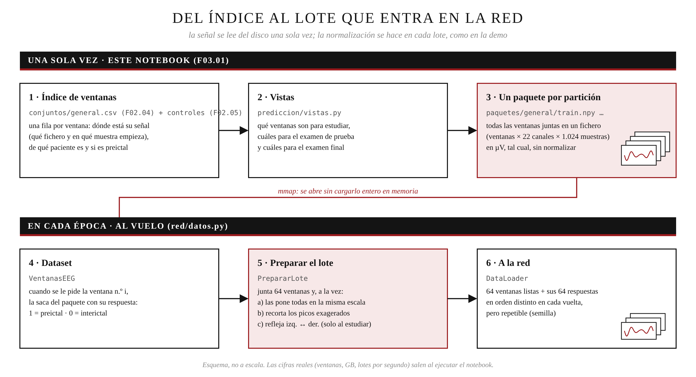

<div align="center">

# 🧠 Fase 3 · Modelo de predicción

### ⏳ preictal frente a 💤 interictal, con una red neuronal

*De los conjuntos de la Fase 2 a una red entrenada, evaluada por paciente y contrastada con los controles de atajos.*


</div>

> ✏️ **Boceto.** Se completa a medida que se añadan notebooks.

---

## 📓 Los notebooks

| | Notebook | Qué hace | Lee | Genera |
|---|---|---|---|---|
| 1️⃣ | `01_datos_red.ipynb` | Arma las **vistas** (entrenamiento, validación, evaluación y controles de `05`), lee cada ventana **una vez** a un **paquete por partición**, comprueba que es idéntico a la señal, elige la **normalización al vuelo** y monta el **Dataset y DataLoader** de PyTorch | `conjuntos/` (04) + `conjuntos_control/` (05) + `senales/` (02) | `paquetes/<conjunto>/` + `vistas.csv` |
| 2️⃣ | `02_…` *(próximamente)* | Declarar la red y entrenarla | `01_datos_red/` | |

<div align="center">

</div>

## ▶️ Cómo ejecutarla

```text
1️⃣  01_datos_red.ipynb      (CONJUNTO = 'general'; la primera vez lee la señal y crea los paquetes)
```

> 💡 Requiere la Fase 2 completa (`01` a `05`). La primera ejecución instala **PyTorch** (con CUDA si hay tarjeta NVIDIA).

## 📁 Archivos generados

```
📂 outputs/fase_03/
└── 📂 01_datos_red/
    ├── 📂 paquetes/<conjunto>/<split>.npy         → ventanas × 22 × 1.024, float16, µV, sin normalizar
    ├── 📂 paquetes/<conjunto>/<split>_indice.csv  → una fila por ventana (mismo orden) y a qué vistas pertenece
    ├── vistas.csv · configuracion.json · summary.txt
    └── 📂 figuras/                                → normalizacion_ejemplo.png
```

> ⚠️ `paquetes/` ocupa varios GB: **no subir a GitHub** (`outputs/**/paquetes/` en el `.gitignore`).

---

<div align="center">

⬅️ [Fase 2 · Preprocesado y ventanas](../fase_02/README.md) · ➡️ Fase 4 · Clasificación de tipos *(próximamente)*

</div>
