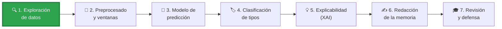
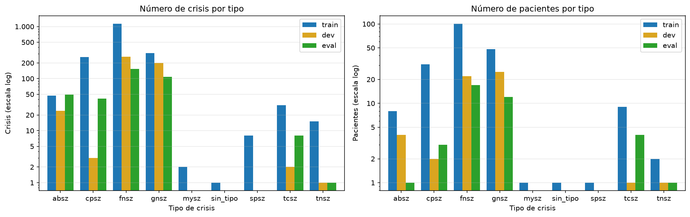

<div align="center">

# 🧠⚡ Predicción, clasificación y explicabilidad de crisis epilépticas con EEG

### Trabajo de Fin de Máster · Máster en Inteligencia Artificial

*Redes neuronales aplicadas al EEG del dataset **TUSZ** para anticipar crisis, identificar su tipo y explicar por qué el modelo decide lo que decide.*


</div>

---

## 📋 Índice

- [🎯 Objetivos](#-objetivos)
- [📦 El dataset: TUSZ v2.0.6](#-el-dataset-tusz-v206)
- [🗺️ Hoja de ruta](#️-hoja-de-ruta)
- [🔍 Hallazgos de la exploración](#-hallazgos-de-la-exploración)
- [🎨 Convención visual](#-convención-visual)
- [📁 Estructura del repositorio](#-estructura-del-repositorio)
- [🚀 Puesta en marcha](#-puesta-en-marcha)

---

## 🎯 Objetivos

| | Objetivo | Pregunta que responde |
|---|---|---|
| 🔮 | **Predicción** | ¿Está a punto de empezar una crisis? *(preictal vs. interictal)* |
| 🏷️ | **Clasificación** | ¿De qué tipo es la crisis? *(focal, generalizada, ausencia…)* |
| 💡 | **Explicabilidad (XAI)** *(anexo)* | ¿En qué canales y frecuencias se fija el modelo? *(SHAP, Grad-CAM)* |

> 💬 Con TUSZ los ficheros duran como mucho 30 min, así que la predicción clásica a 30–60 min no es viable. El TFM se centra en la **anticipación a corto plazo** (minutos).

---

## 📦 El dataset: TUSZ v2.0.6

El [**Temple University Hospital EEG Seizure Corpus**](https://isip.piconepress.com/projects/nedc/html/tuh_eeg/) es el mayor corpus público de EEG con crisis anotadas por tipo.

<div align="center">

| 💾 Tamaño | 📄 Ficheros EDF | 👥 Pacientes | ⚡ Con crisis | 🔢 Crisis | ⏱️ Horas |
|:---:|:---:|:---:|:---:|:---:|:---:|
| **81,4 GB** | **8.140** | **675** | **238** | **2.664** | **≈ 1.475** |

</div>

| Partición | 👥 Pacientes | 📄 Ficheros | ⏱️ Horas | ⚡ Crisis |
|---|---:|---:|---:|---:|
| 🔵 `train` | 579 | 5.057 | 910,7 | 1.812 |
| 🟡 `dev` | 53 | 2.203 | 435,5 | 492 |
| 🟢 `eval` | 43 | 880 | 128,6 | 360 |

✅ **Sin *data leakage***: ningún paciente aparece en dos particiones.

> ⚠️ El dataset **no está en el repositorio** (`00.TUSZ/` está en `.gitignore`). Hay que solicitar acceso a la NEDC de Temple University.

---

## 🗺️ Hoja de ruta



| Fase | Estado | Contenido |
|---|:---:|---|
| 🔍 **1 · Exploración** | 🟢 En curso | Inventario del corpus, EDA, elección del umbral de lead-in |
| 🧹 **2 · Preprocesado** | ⏳ | Montaje TCP de 22 canales, remuestreo a 256 Hz, ventanas preictal/interictal, balanceo |
| 🔮 **3 · Predicción** | ⏳ | Entrenar, ajustar y evaluar (sensibilidad, AUC-PR, falsas alarmas/hora) |
| 🏷️ **4 · Clasificación** | ⏳ | `fnsz`, `gnsz`, `cpsz`, `absz`, `tcsz` · F1 macro |
| 💡 **5 · XAI** | ⏳ | SHAP / Grad-CAM sobre ambos modelos |
| ✍️ **6 · Memoria** | ⏳ | Redacción completa |
| 🎓 **7 · Defensa** | ⏳ | Revisión final y presentación |

---

## 🔍 Hallazgos de la exploración

<div align="center">

</div>

### ⏱️ El *lead-in* y el umbral de 5 minutos

El **lead-in** es el tiempo **sin crisis** que hay justo antes de una crisis, medido dentro de su mismo fichero. La ventana preictal que usará el modelo tiene que caber dentro.

```
0 min ──── limpio ──── 6 min [⚡ CRISIS A] 7 min ── 2 min ── 9 min [⚡ CRISIS B] 10 min ──── 20 min
                       └─ lead-in A = 6 min ┘          └ lead-in B = 2 min ┘
```

| Lead-in mínimo | 🔵 train | 🟡 dev | 🟢 eval |
|:---:|:---:|:---:|:---:|
| 2 min | 534 crisis · 128 pac. | 278 · 37 | 169 · 29 |
| **5 min ⭐** | **230 · 89** | **160 · 30** | **89 · 26** |
| 7 min | 97 · 64 | 98 · 24 | 33 · 17 |
| 10 min | 35 · 30 | 46 · 17 | 8 · 6 |
| 15 min | 8 · 8 | 19 · 7 | 4 · 4 |

⭐ **5 min** es el último umbral antes de que 🟢 `eval` se quede con muy pocos pacientes.

### 📌 Lo que condiciona las siguientes fases

- 🎛️ **Montajes**: domina `01_tcp_ar` (75 %). `02_tcp_le` solo aparece en train → se construirá el **montaje TCP bipolar de 22 canales** en todos los ficheros.
- 📶 **Frecuencias**: domina 256 Hz (75 %; 95 % en eval) → **remuestrear todo a 256 Hz**.
- ⚖️ **Desequilibrio fuerte**: solo el 3 % del tiempo registrado es crisis, y 🟥 `fnsz` + 🟦 `gnsz` + 🟧 `cpsz` suman el 93 % de las crisis.
- 🟩 **Ausencias**: muy cortas (mediana ≈ 7 s) y las 49 de eval son de **un único paciente**.
- 👤 **Concentración**: los 10 pacientes con más crisis aportan el 32 % → se limitarán las ventanas por paciente.
- 🧽 **Limpieza**: 653 ficheros duran menos de 1 min y hay 1 crisis de 0 s.

---

## 🎨 Convención visual

En todo el TFM (notebooks, tablas y memoria) se usan los mismos iconos, definidos en [`tfm_comun/iconos.py`](03.Codigo/ALMA/tfm_comun/iconos.py).

<table>
<tr><th>Etiquetas de TUSZ</th><th>Particiones</th></tr>
<tr><td>

| | Etiqueta | Significado |
|---|---|---|
| ⬜ | `bckg` | Fondo, sin crisis |
| ⬛ | `seiz` / `sin_tipo` | Crisis sin tipo |
| 🟥 | `fnsz` | Focal no específica |
| 🟦 | `gnsz` | Generalizada no específica |
| 🟧 | `cpsz` | Parcial compleja |
| 🟩 | `absz` | Ausencia |
| 🟪 | `tcsz` | Tónico-clónica |
| 🟨 | `tnsz` | Tónica |
| 🟫 | `spsz` | Parcial simple |
| 🔳 | `mysz` | Mioclónica |

</td><td valign="top">

| | Partición | Color en figuras |
|---|---|---|
| 🔵 | `train` | azul |
| 🟡 | `dev` | goldenrod |
| 🟢 | `eval` | verde |
| ⚪ | `todas` | — |
| 🔴 | *avisos* | — |

</td></tr>
</table>

---

## 📁 Estructura del repositorio

```
📂 TFM IA/
├── 📂 00.TUSZ/                      🚫 dataset (fuera de git)
├── 📂 01.Documentacion/            📚 guías del curso de MNE, sistema 10-20, lead-in
├── 📂 02.Notas/                    📝 resumen del AAREADME de TUSZ
├── 📂 03.Codigo/
│   ├── 📂 ALMA/                    ⭐ código del TFM
│   │   ├── 📓 01_inventario_tusz.ipynb   → inventario de los 8.140 EDF y sus crisis
│   │   ├── 📓 02_eda_tusz.ipynb          → análisis exploratorio y conclusiones
│   │   ├── 📦 tfm_comun/                 → utilidades compartidas (una responsabilidad por módulo)
│   │   │   ├── particiones.py · iconos.py · colores.py
│   │   │   └── numeros.py · ejes.py
│   │   └── 📂 outputs/                   → CSV, figuras y resúmenes generados
│   │       ├── 01_inventario/  (edfs.csv, crisis.csv)
│   │       └── 02_eda/         (dominancias, umbrales, figuras/)
│   ├── 📂 Curso Claude MNE/        🎓 curso práctico de MNE-Python sobre TUSZ (00–09)
│   ├── 📂 Inventario/              🗃️ versión inicial del inventario en script
│   └── 📂 Muestras Codigo Buenas Practicas/   ✨ notebooks de referencia de estilo
└── 📂 04.Memoria/                  ✍️ redacción del TFM
```

---

## 🚀 Puesta en marcha

**1️⃣ Instalar dependencias**

```bash
pip install -U pandas matplotlib scipy scikit-learn torch mne jupyter
```

**2️⃣ Colocar el dataset** en `00.TUSZ/v2.0.6/` (las rutas se calculan solas desde la carpeta de los notebooks).

**3️⃣ Ejecutar los notebooks en orden**

| | Notebook | Qué hace | Lee | Genera |
|---|---|---|---|---|
| 1️⃣ | `01_inventario_tusz.ipynb` | Lee cabeceras EDF y anotaciones *(no carga señal, tarda minutos)* | `00.TUSZ/` | `outputs/01_inventario/` |
| 2️⃣ | `02_eda_tusz.ipynb` | Tablas, figuras y conclusiones | `outputs/01_inventario/` | `outputs/02_eda/` |

> 💡 Los CSV se guardan **sin iconos** para leerlos fácilmente desde código; los iconos solo se añaden al mostrar las tablas.

---

<div align="center">

**Hecho con 🧠, ☕ y muchas horas de EEG por Daniel Gómez**

*Dataset: Temple University Hospital EEG Seizure Corpus (TUSZ) v2.0.6 · NEDC, Temple University*

</div>
