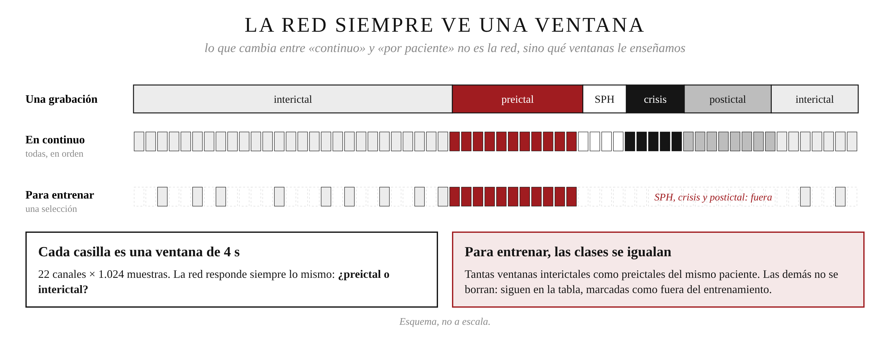
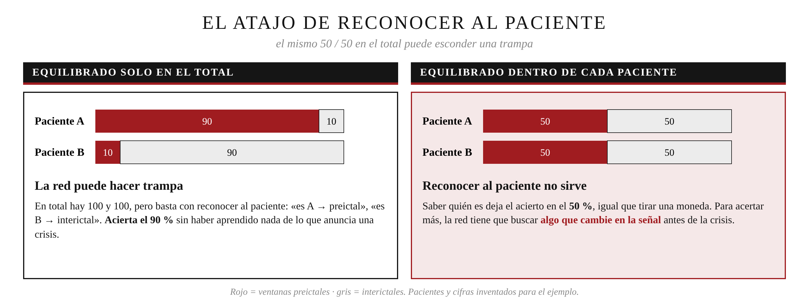
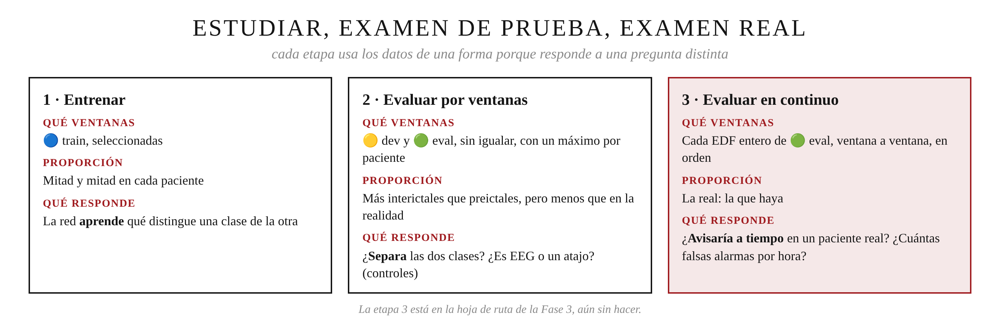

# ⚖️ Entrenar por paciente, evaluar en continuo

### Por qué la red no aprende con los EEG enteros, y por qué sí hay que examinarla con ellos

*Guía didáctica de una decisión que condiciona todo el TFM.*

> 🧭 **En 30 segundos**
> - La red nunca clasifica pacientes ni registros: siempre recibe **una ventana de 4 s** y responde 💤 interictal o ⏳ preictal.
> - **Por paciente** es la forma de elegir y repartir esas ventanas, para que la red aprenda EEG y no a reconocer personas.
> - **En continuo** es la forma de examinarla al final, porque así funcionaría con un paciente real.
> - Es como un piloto: **entrena** en un simulador con muchas más emergencias de las reales, pero se le **examina** en vuelos normales.

*Cifras del modelo general ([F02.04](03.Codigo/ALMA/fase_02/04_particiones_y_balanceo.ipynb), ejecución del 3 de noviembre de 2026). Si se repite ese notebook, pueden cambiar: la fuente son `summary.txt` y `conjuntos/general.csv`.*

---

## 1. La red siempre ve una ventana

Incluso «en continuo», la red ve una ventana cada vez, una detrás de otra. Por eso la pregunta real no es *«¿por paciente o en continuo?»*, sino:

> **¿Qué ventanas le enseñamos, y en qué proporción, en cada etapa?**

---

## 2. Por qué no se entrena en continuo

### ⚖️ Motivo 1: aprendería a decir siempre «normal»

Aun después de recortar 💤 interictal, en 🔵 train hay **6,9 ventanas 💤 interictales por cada ⏳ preictal**. Una red que responda siempre «💤 interictal» acierta así, sin predecir nada:

| Partición | Acierto diciendo siempre 💤 interictal |
|---|---:|
| 🔵 train | 87,3 % |
| 🟡 dev | 80,9 % |
| 🟢 eval | 82,8 % |
| 🔵 train **equilibrado** | **50 %** (no gana nada) |

Por eso el **acierto (*accuracy*)** no sirve aquí como medida.

### 👤 Motivo 2: unos pocos pacientes dominarían

Quien tiene más horas grabadas pesaría más. Por eso hay un **máximo de 2 h de 💤 interictal por paciente**. Esto es lo que aporta el paciente con más horas:

| Partición | Antes del máximo | Después |
|---|---:|---:|
| 🔵 train | 7,9 % | 1,2 % |
| 🟡 dev | **30,6 %** | 3,8 % |
| 🟢 eval | 8,8 % | 4,5 % |

### 🏷️ Motivo 3: hay tramos sin una etiqueta limpia

El SPH, la crisis y el postictal no son ni 💤 interictal ni ⏳ preictal. Si se metieran a la fuerza, se enseñaría a la red con respuestas dudosas.

---

## 3. Por qué se equilibra dentro de cada paciente

Igualar solo el total no basta:

Esto no es un caso teórico. En 🔵 train hay **162 pacientes**:

| Pacientes de 🔵 train | Cuántos |
|---|---:|
| Con 💤 interictal y ⏳ preictal | 84 |
| Solo con 💤 interictal | 69 |
| Solo con ⏳ preictal | 9 |

Entre los 93 que tienen ⏳ preictal, su porcentaje de ⏳ va del **3 % al 100 %** (mediana: 20 %). Sin equilibrar, saber quién es el paciente ya sería una pista muy fuerte.

**El resultado:** 84 pacientes, con **18.417 ventanas ⏳ preictales y 18.417 💤 interictales**, exactamente mitad y mitad en cada uno.

**Lo que cuesta:** 78 pacientes y el 16 % de las ⏳ preictales de 🔵 train se quedan fuera del entrenamiento. Se acepta porque una ventana que solo enseña a reconocer a alguien no ayuda con un paciente nuevo.

---

## 4. «Por paciente» significa cuatro cosas

Conviene no mezclarlas, sobre todo en la memoria y en la defensa:

| | Qué se hace | Qué evita | Dónde |
|---|---|---|---|
| 🚧 **Particiones** | Ningún paciente está en dos de ellas | Que el examen incluya a alguien ya visto | F02.04 |
| ✂️ **Máximo** | Hasta 2 h de 💤 interictal por paciente | Que uno pese más que los demás | F02.04 |
| ⚖️ **Equilibrado** | Mitad y mitad dentro de cada paciente (solo al entrenar) | El atajo de reconocerlo | F02.04 |
| 📏 **Intervalos** | Se sortean pacientes, no ventanas (*bootstrap*) | Creer que hay más datos de los que hay | `prediccion/metricas.py` |

> ⚠️ **No confundir con un modelo «paciente-específico»**, que se entrena con crisis de la misma persona que luego examina. El nuestro es **entre pacientes** (*cross-patient*): se examina con personas que nunca ha visto. Es lo más difícil y suele dar cifras peores, pero es lo que serviría para alguien nuevo.

---

## 5. Por qué también hay que evaluar en continuo

Cada etapa responde a una pregunta distinta:

La evaluación por ventanas aún no se parece del todo a la realidad, porque el máximo por paciente y la selección de tramos dejan fuera mucha grabación:

| Horas | ⏳ preictal | 💤 interictal usada | Grabación total | Horas usadas de 💤 por hora de ⏳ | Horas grabadas por hora de ⏳ |
|---|---:|---:|---:|---:|---:|
| 🟡 dev | 6,2 | 52,5 | 435,5 | 8,5 | **≈ 70** |
| 🟢 eval | 4,7 | 44,7 | 128,6 | 9,6 | **≈ 28** |

Además, 13 de los 43 pacientes de 🟢 eval no están en el conjunto general.

**Qué se gana:** las **falsas alarmas por hora** solo tienen sentido sobre las horas de verdad. Una red que da una falsa alarma cada pocos minutos puede tener una buena nota por ventana y ser inútil para un paciente.

### Dos formas de medir

| | Por ventana | En continuo |
|---|---|---|
| **Pregunta** | ¿Esta ventana es ⏳ preictal? | ¿Avisó antes de esta crisis? |
| **Unidad** | Ventana de 4 s | Crisis y hora de grabación |
| **Medidas** | AUROC, AUC-PR | Sensibilidad por crisis, falsas alarmas/hora, tiempo de aviso |
| **Para qué sirve** | Comparar modelos y detectar atajos | Saber si serviría en la práctica |

Hay que dar **las dos**, y comparar la segunda con un **predictor aleatorio**: en predicción de crisis, un resultado que parece bueno puede no superar al azar. La literatura recogida en la síntesis del TFM avisa de que la medida por alarma suele salir menos favorable.

> 🛑 **El límite:** «continuo» significa dentro de cada EDF. No se encadenan ficheros porque no se puede verificar que sean consecutivos.

El plan está en la [hoja de ruta](README.md#️-hoja-de-ruta) y en la [Fase 3](03.Codigo/ALMA/fase_03/README.md).

---

## 6. Preguntas que pueden hacerte en la defensa

<b>¿No sería más realista entrenar con todos los datos?</b>

Más realista, sí, pero no enseña mejor: la red tendería a responder la clase mayoritaria y a apoyarse en los pacientes con más horas. El realismo se exige en el examen, no en el entrenamiento.

<b>¿Y entrenar con todo usando pesos por clase?</b>

Resuelve el motivo 1 (en 🔵 train, cada ⏳ preictal pesaría 3,94), pero no el atajo: los pesos igualan el total, no el reparto dentro de cada paciente. F02.04 conserva todas las ventanas, así que se puede probar como experimento en la Fase 3.

<b>¿Equilibrar no infla los resultados?</b>

Solo si también se equilibrara el examen. 🟡 dev y 🟢 eval no se equilibran, y la evaluación en continuo usa la proporción real.

<b>¿Esto elimina todos los atajos?</b>

No. Por ejemplo, las ⏳ preictales solo salen de ficheros con crisis, y esa diferencia puede servir de pista. Por eso la red también se evalúa en los conjuntos de control de F02.05.

---

## 📖 Glosario

| Término | Qué significa |
|---|---|
| **Ventana** | Trozo de 4 s de EEG: 22 canales × 1.024 muestras |
| **💤 Interictal** | Señal lejos de cualquier crisis |
| **⏳ Preictal** | Minutos antes de la crisis: lo que se quiere reconocer |
| **SPH** | Margen justo antes de la crisis que no se usa: el tiempo para reaccionar |
| **Equilibrar** | Dejar el mismo número de ventanas de cada clase |
| **Atajo** | Pista que permite acertar sin aprender lo que se busca |
| **Sensibilidad por crisis** | De todas las crisis, cuántas se avisaron a tiempo |
| **FA/h** | Falsas alarmas por hora de grabación |
| **AUROC** | Probabilidad de puntuar más alto una ⏳ preictal que una 💤 interictal (0,5 = azar) |
| **Predictor aleatorio** | Alarmas al azar, con la misma frecuencia: la referencia que hay que superar |

---

📚 [README del proyecto](README.md) · ⚙️ [Fase 2](03.Codigo/ALMA/fase_02/README.md) · 🧠 [Fase 3](03.Codigo/ALMA/fase_03/README.md)

